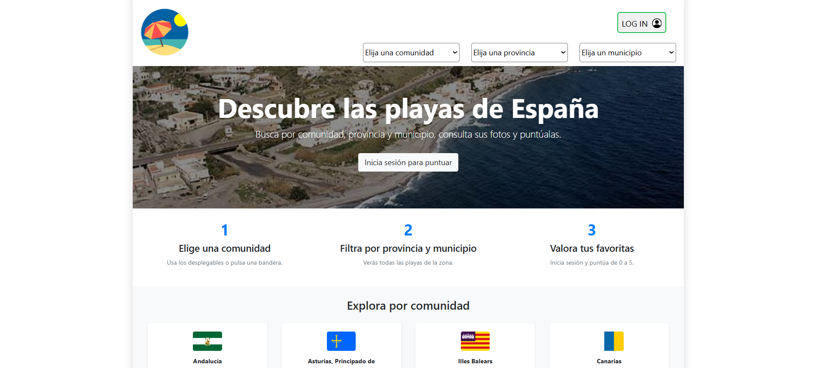
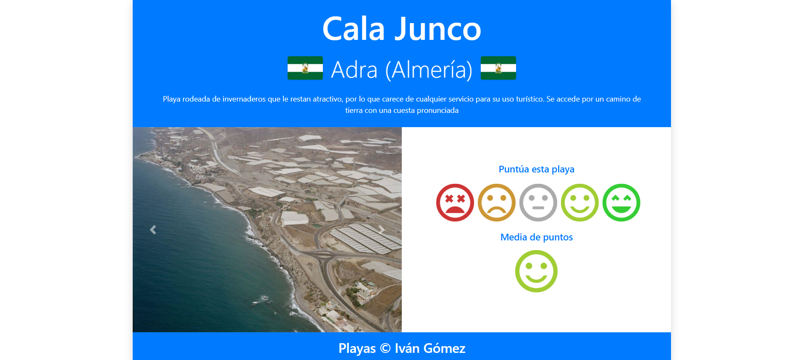
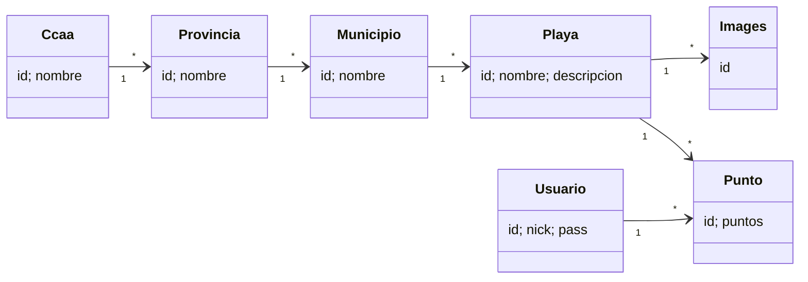

# 🏖️ Playas — Spanish Beaches Guide (Java EE + JPA)

A web application for exploring Spain's beaches. Users filter beaches by **autonomous community → province → municipality**, view photos and descriptions, and, once logged in, **rate** them from 0 to 5.

> 🎓 **Academic project.** Built for the **Data Access** module (*Acceso a Datos*) of the **Higher National Diploma in Multiplatform Application Development** (*CFGS Desarrollo de Aplicaciones Multiplataforma, DAM*), 2nd year.

---

## 📸 Screenshots

| Home | Beach detail |
|---|---|
|  |  |

---

## ✨ Features

- **Cascading filters**: community → province → municipality, each selection reloading the next list.
- **Beach cards** with a cover photo, name and description. Beaches without photos show a *"No photo available"* placeholder.
- **Detail page** with a photo carousel, the community's flag, the location, a description and the average rating.
- **Ratings (0–5)** for logged-in users. The average is shown as an icon.
- **Ratings popup** on each card, loaded asynchronously with **AJAX** (jQuery).
- **Login & register in one step**: if the nickname doesn't exist, a new user is created.
- **Zero setup**: an embedded H2 database is created and filled automatically on startup (3,400+ beaches).
- **Welcome page** with quick access to each community.
- Responsive layout with **Bootstrap 4**.

---

## 🧰 Tech Stack

| Layer | Technology |
|---|---|
| Language | Java |
| Persistence | **JPA 2.1** (EclipseLink) with `@NamedQuery`, `@OneToMany` / `@ManyToOne` |
| Database | **H2** embedded in-memory (Oracle compatibility mode). Originally Oracle |
| Web | Servlets (front controller) + JSP |
| Frontend | HTML, CSS, Bootstrap 4, jQuery, AJAX |
| Server | Apache Tomcat |
| IDE / build | NetBeans (Ant) |

---

## 🏗️ Architecture

MVC with a single **front controller** servlet (`Controller`) that routes on the `op` parameter:

| `op` | Action |
|---|---|
| `inicio` | Loads communities and shows the home page |
| `vacomunidad` / `vaprovincia` / `vamunicipio` | Cascading filters |
| `login` / `logout` | Session management (login or register) |
| `detail` | Beach detail page |
| `vapuntos` | Saves a user's rating |
| `puntuacion` | Returns the ratings HTML fragment (AJAX) |

Data access goes through an `EntityManager` from a shared `JPAUtil` factory. On startup, `JPAUtil` loads `src/java/db/playas.sql` into an in-memory H2 database, so the app always starts with the same sample data. IDs for users and ratings are generated with JPA `@SequenceGenerator` sequences. The view state (selected filters, user, messages) is kept in the HTTP session.

### Domain model



---

## 📁 Project Structure

```
PlayasJPA/
├── src/
│   ├── conf/
│   │   └── persistence.xml        # H2 connection (no credentials needed)
│   └── java/
│       ├── controller/Controller.java
│       ├── db/playas.sql          # Schema + sample data, loaded on startup
│       ├── entities/              # JPA entities
│       └── util/JPAUtil.java
├── web/
│   ├── home.jsp                   # Filters, cards, login modal
│   ├── detail.jsp                 # Carousel and rating
│   ├── puntuacion.jsp             # AJAX ratings fragment
│   ├── myjs.js · mycss.css
│   └── img/                       # Partial image set (see below)
├── lib/h2-1.4.200.jar             # Embedded database driver
├── screenshots/
└── build.xml / nbproject/
```

---

## 🖼️ About the images

**Not all beach images are included in this repository.** The full photo set is very large, so only a **sample** is uploaded: enough to show the cards, the carousel and the rating icons. Beaches without a photo, either because none is registered in the database or because the file isn't included, show a grey *"No photo available"* placeholder instead of a broken image. The application works exactly the same.

Images follow the naming pattern `img/<beachId>_<imageId>.jpg`, flags are `img/ccaa_<communityId>.png`, and rating icons are `img/ic_<0-5>.png`.

---

## 🚀 Running Locally

**No database setup needed.** The data is loaded automatically into an embedded H2 database every time the app starts.

### Prerequisites
- JDK 8
- Apache Tomcat 8+
- NetBeans (Java EE / Jakarta EE support)

### Steps
1. Clone the repository and open the project in NetBeans:
   ```bash
   git clone https://github.com/ivangomezr/spanish-beaches-jpa.git
   ```
2. Run it on Tomcat.
3. Open `http://localhost:8080/PlayasJPA/`.

**Demo user:** `demo` / `demo`. You can also log in with any new nickname and password; the account is created automatically.

> ℹ️ The database is in memory, so new users and ratings are reset every time the server restarts. The original project used the school's Oracle server; it was migrated to H2 so anyone can run it without configuration.

---

## 🙋 Author

**Iván Gómez** — [@ivangomezr](https://github.com/ivangomezr)

Developed as coursework for the *Data Access* module, DAM.
